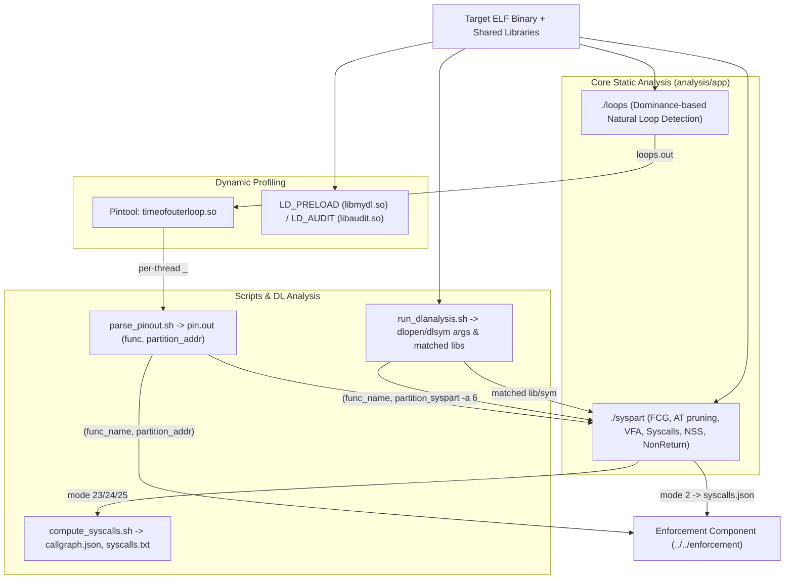

# Analysis Subsystem

The `analysis/` directory contains everything needed to statically and dynamically analyze x86-64 Linux ELF binaries (and their shared libraries) to build refined interprocedural call graphs, compute reachable system calls, resolve dynamically loaded libraries (`dlopen`/`dlsym`), and detect server serving-phase boundaries.

## Directory Layout

| Path | Component | Purpose |
| --- | --- | --- |
| [app/](app/README.md) | Core Analysis Engine | Builds `syspart` and `loops` binaries on top of `libegalito.so`; orchestrates callgraph construction, indirect-call refinement, syscall reachability, loop detection, noreturn analysis, and NSS resolution. |
| [app/src/scripts/](app/src/scripts/README.md) | Workflow & Post-Processing Scripts | End-to-end syscall pipelines (`compute_syscalls*.sh`), JSON callgraph compression, BFS reachability, Pin/TypeArmor output parsers, and `main` discovery. |
| [app/src/dlanalysis/](app/src/dlanalysis/README.md) | Dynamic Library (`dlopen`/`dlsym`) Analysis | Static value-flow argument resolution, symbol-to-library matching, Mermaid callgraph tracing, and dynamic `LD_PRELOAD` / `LD_AUDIT` tracers. |
| [app/src/pintool/](app/src/pintool/README.md) | Serving-Phase Loop Profiler | Intel Pin tool (`timeofouterloop.cpp`) and workload generators (`server_request_scripts/`) to identify the dominant serving loop at runtime. |
| [tools/](tools/README.md) | External Tooling | Egalito binary analysis/rewriting framework (Git submodule) and Intel Pin 3.11 archive. |

## End-to-End Data Flow

## Building

Always build from the repository root using one of the two helper scripts:

- **Ubuntu 18.04 (original environment):** `./build.sh` — checks out `syspart-updated` in `analysis/tools/egalito`, builds Egalito with `USE_LOADER=0`, then builds `analysis/app`.
- **Ubuntu 22.04/24.04 & Debian 12/13:** `./build_upgraded_egalito.sh` — checks out `master` in `analysis/tools/egalito`, initializes `capstone`/`distorm3`/`keystone` submodules, builds `analysis/tools/egalito/src`, then builds `analysis/app`.

Both produce symlinked executables `analysis/app/syspart` and `analysis/app/loops` (pointing into `analysis/app/build_x86_64/`).

## Quick Navigation for Developers & Agents

- **Looking for CLI flags or `-a <mode>` behavior?** Read [analysis/app/README.md](app/README.md) (`testSyspart.cpp` & `syspart.cpp`).
- **Debugging indirect call resolution or callgraph edges?** See `IPCallGraph` and `SyspartUtility` in [analysis/app/README.md](app/README.md).
- **Running the scalable syscall extraction pipeline?** See [analysis/app/src/scripts/README.md](app/src/scripts/README.md).
- **Investigating `dlopen`/`dlsym` resolution?** See [analysis/app/src/dlanalysis/README.md](app/src/dlanalysis/README.md).
- **Profiling server main loops with Pin?** See [analysis/app/src/pintool/README.md](app/src/pintool/README.md).
